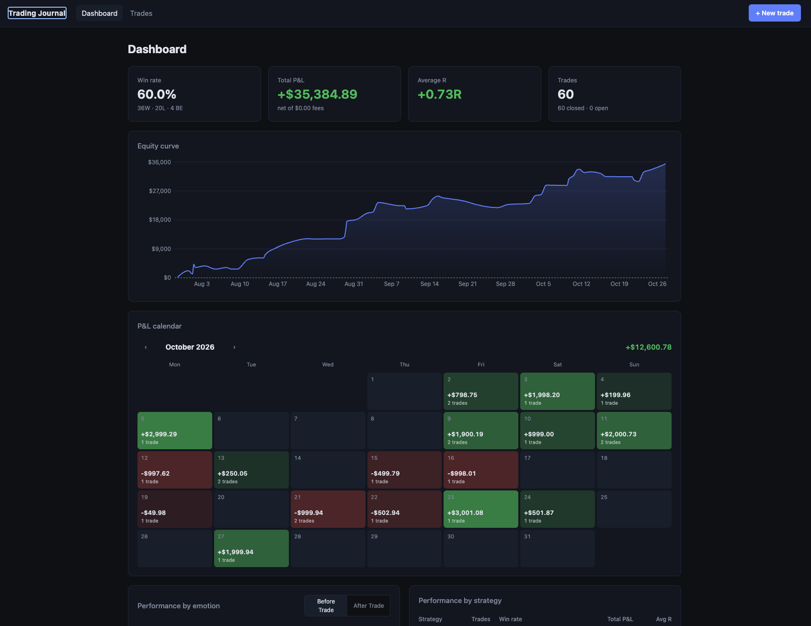
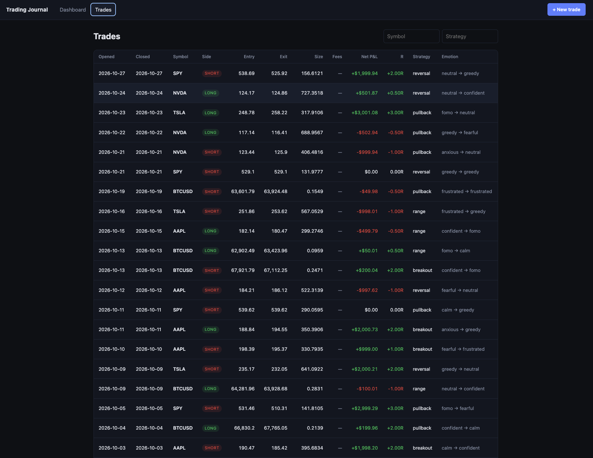
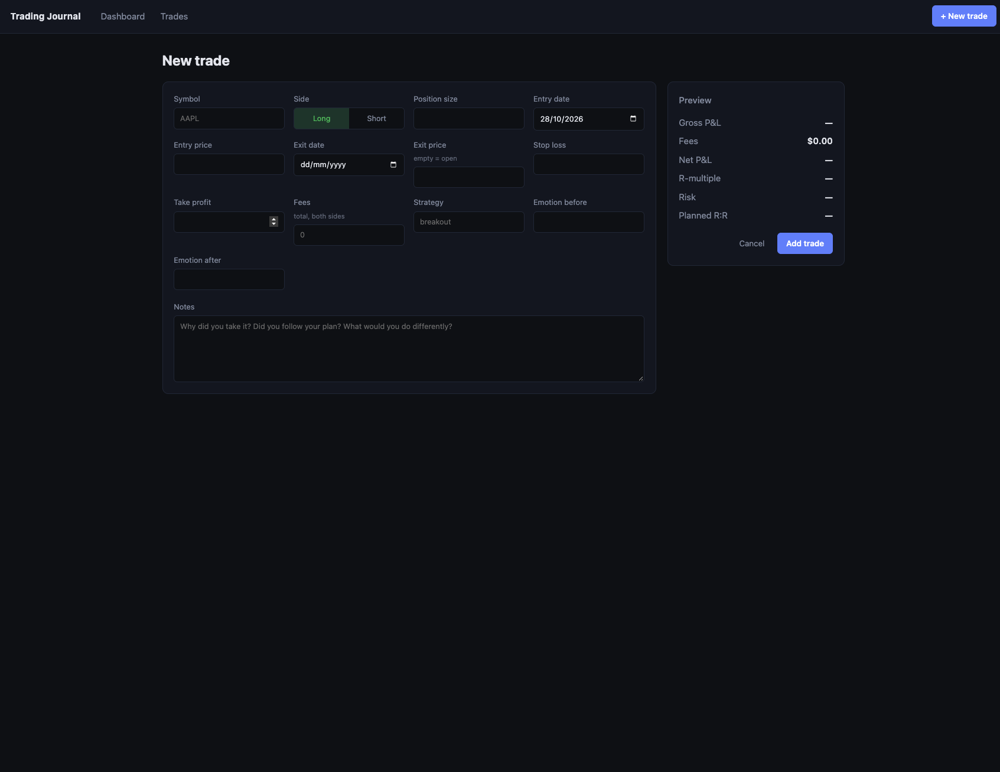
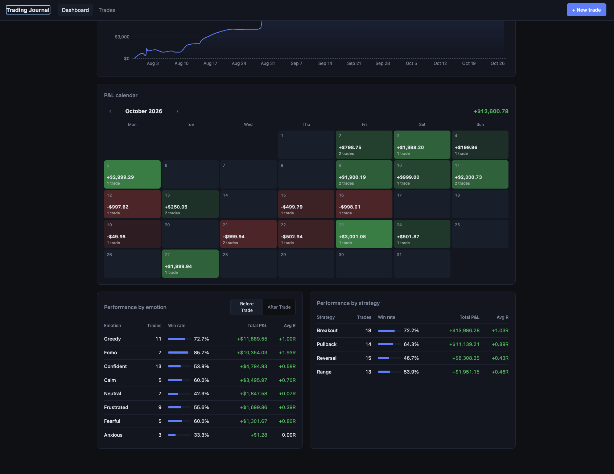

# Trading Journal

A self-hosted journal for reviewing your own trades. Log every trade with its plan, outcome and the emotions around it, and the dashboard shows where your results actually come from: which setups work, which states of mind cost you money, and how your equity has grown over time.

It is a review tool, not a trading tool: there are no signals, no broker connections and no automated trading.



## Features

**Trade log**
- Add, view, edit and delete trades: symbol, long/short, entry and exit price, position size, stop loss, take profit, fees, entry and exit date, strategy tag, notes, and emotion before and after the trade
- P&L and R-multiple calculated automatically for every trade, net of fees
- Live preview in the form of gross and net P&L, R-multiple, amount at risk and planned reward-to-risk before you save
- Validation that catches common logging mistakes, such as a stop loss on the wrong side of the entry or an exit before the entry date
- Filter by symbol or strategy as you type

**Dashboard**
- Win rate, total net P&L, total fees, average R and open/closed trade counts
- Equity curve on a real time axis, so gaps between trades show as real time
- Monthly P&L calendar, with each day shaded by how much was made or lost
- Performance by strategy and by emotion (before or after the trade): win rate, total P&L and average R for each

| Trade list | Trade form |
|---|---|
|  |  |

## Performance analytics

Below the equity curve, the P&L calendar shows each day's result at a glance, and the breakdown tables group closed trades by strategy and by emotion. Each row shows the number of trades, win rate, total net P&L and average R, sorted from best to worst total P&L. Switch the emotion table between *before* and *after* the trade to compare the state of mind you entered with against how you felt about the result. Emotions and strategies are grouped without regard to case, and untagged trades get their own row.

This is where patterns show up, such as one setup carrying most of your profit, or trades taken while anxious or chasing (FOMO) losing more often.



## Tech stack

| Layer | Technology |
|---|---|
| Backend | Python 3.11+, FastAPI, SQLAlchemy 2, Pydantic 2 |
| Database | SQLite, schema managed with Alembic (the URL is configurable for PostgreSQL) |
| Frontend | React 19, Vite, React Router, Recharts |
| Tests | pytest (backend), Vitest (frontend) |

## Getting started

You need Python 3.11+ and Node.js 20.19+ or 22.12+. Run the backend and frontend in separate terminals.

**Backend**, at http://localhost:8000 (interactive API docs at `/docs`):

```bash
cd backend
python3 -m venv .venv
.venv/bin/pip install -r requirements.txt
.venv/bin/uvicorn app.main:app --reload
```

**Frontend**, at http://localhost:5173:

```bash
cd frontend
npm install
npm run dev
```

The Vite dev server forwards `/api` requests to the backend, so no CORS setup is needed during development.

**Optional sample data**, to try the dashboard:

```bash
cd backend
.venv/bin/python -m app.seed 60      # adds 60 random sample trades
```

To start over with an empty journal, stop the backend, delete `backend/trading_journal.db`, and start it again.

### Running the tests

```bash
cd backend && .venv/bin/python -m pytest
cd frontend && npm test
```

### Configuration

| Variable | Default | Purpose |
|---|---|---|
| `DATABASE_URL` | `sqlite:///./trading_journal.db` | SQLAlchemy database URL |
| `CORS_ORIGINS` | `http://localhost:5173,http://127.0.0.1:5173` | Comma-separated origins allowed to call the API |

### Database migrations

The database schema is upgraded automatically when the backend starts. After changing `backend/app/models.py`, generate a migration, check it, and commit it:

```bash
cd backend
.venv/bin/alembic revision --autogenerate -m "describe the change"
.venv/bin/alembic upgrade head        # or just restart the backend
```

## How P&L and R are calculated

All figures are worked out from the stored trade fields each time they are read, so editing a trade can never leave out-of-date numbers behind.

**P&L**

```
direction = +1 for long, −1 for short
gross P&L = (exit price − entry price) × position size × direction
net P&L   = gross P&L − fees
```

"P&L" in the app always means **net** P&L. The fees field is the total cost of the trade, both sides.

**R-multiple**

R expresses a result in units of what the trade risked at the stop loss:

```
risk = |entry price − stop loss| × position size
R    = net P&L ÷ risk
```

Example: a long from 100 with a stop at 95 and size 10 risks $50. Exiting at 110 makes $100 gross; with $10 in fees the net P&L is $90, which is **+1.8R**. Because fees are included, a trade stopped out exactly at its stop is slightly worse than −1R.

**Rules and edge cases**
- A trade is **open** until it has both an exit price and an exit date. Open trades have no P&L or R and are left out of the statistics.
- Trades without a stop loss have P&L but no R. They are left out of average R.
- The stop loss must be below the entry for longs and above it for shorts; take profit the other way around.
- **Win rate** = trades with net P&L above zero ÷ closed trades. Break-even trades count as non-wins.
- **Average R** = mean R of the closed trades that have a stop loss.
- Closed trades are dated by their **exit date** in the equity curve, P&L calendar and dashboard date filters, because that is when the P&L is made. The trade list is sorted and filtered by entry date.
- Results are rounded to cents only for display, after all calculations are done.

## API

| Method | Path | Description |
|---|---|---|
| `GET` | `/api/trades?symbol=&strategy=&start=&end=` | List trades, newest entry first (partial matches; dates filter on entry date) |
| `POST` | `/api/trades` | Create a trade |
| `GET` / `PUT` / `DELETE` | `/api/trades/{id}` | Read, replace or delete a trade |
| `GET` | `/api/stats?start=&end=&strategy=` | Summary, equity curve, daily P&L and breakdowns (dates filter on exit date) |
| `GET` | `/api/health` | Health check |

## Project structure

```
backend/
  app/
    main.py          FastAPI app, CORS, startup migrations
    models.py        Trade table
    schemas.py       Request/response validation and computed P&L and R
    metrics.py       P&L, R and statistics (plain functions, unit tested)
    routers/         /api/trades and /api/stats
    migrate.py       Runs Alembic migrations on startup
    seed.py          Sample data generator
  alembic/           Database migrations
  tests/
frontend/
  src/
    pages/           Dashboard, trade list, trade form
    components/      Equity chart, P&L calendar, stat cards, breakdown tables
    lib/             API client, formatting, trade math, calendar and time-axis helpers
docs/screenshots/
```
